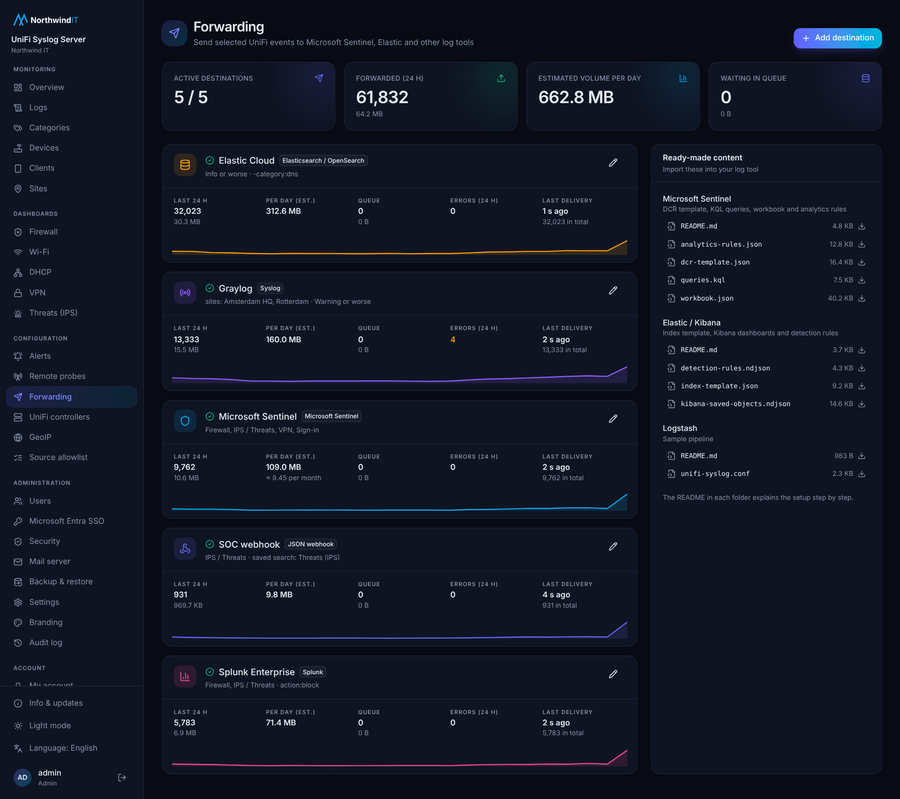

# Forwarding

Under **Forwarding** you send UniFi events on to a SIEM or log tool, in parallel with storing them locally. Each destination has its own filters, queue and statistics. Bundled content for the destinations is in [`integrations/`](../integrations):

- [Microsoft Sentinel](../integrations/sentinel/README.md): DCR template, workbook, hunting queries, analytics rules
- [Elasticsearch / Elastic Cloud / OpenSearch](../integrations/elastic/README.md): index template, Kibana dashboard, detection rules
- [Logstash](../integrations/logstash/README.md): sample pipeline

## Destinations

| Type | How it is sent | Format |
|---|---|---|
| **Microsoft Sentinel** | Logs Ingestion API (HTTPS) to a data collection endpoint, through a data collection rule. Entra app with client secret or certificate. | Table `UnifiSyslog_CL`; in *split* mode firewall and IPS events go to `CommonSecurityLog` |
| **Elasticsearch / Elastic Cloud / OpenSearch** | Bulk API into a data stream (default `logs-unifi.syslog-default`). API key or basic auth. **Install index template** puts the mappings in place. | Elastic Common Schema (ECS) |
| **Logstash** | TCP (JSON lines), TLS, or HTTP (JSON array) | ECS |
| **Syslog** | UDP, TCP or TLS | RFC 5424 with structured data, or CEF. On TCP/TLS: octet-counting (RFC 6587) or newline framing |
| **Webhook** | HTTP POST of a JSON array, custom headers (e.g. `Authorization`) | ECS or the app's native field names |
| **Splunk HTTP Event Collector** | HTTPS to the HEC endpoint with a HEC token | JSON events |

Every destination has a **Test** button that sends one test event (`category: system`, `event_type: test`).

## Filters

A destination forwards only events that match **all** of its filters (AND):

- **Categories**: e.g. firewall, ips, auth, vpn, admin, access. Empty is all.
- **Sites** and **devices**. Empty is all.
- **Max severity**: e.g. `warning` forwards emergency up to warning.
- **Saved search**: one of your saved searches or categories.
- **Extra query**: any query in the app's [query language](../README.md#query-language), e.g. `-category:dns -(category:firewall action:allow)`.

Filters apply to new events; changing them does not resend older events.

## Reliability

- Events are sent in **batches** (up to a size that suits the destination type; waiting events go out within a few seconds).
- Each destination has its own **on-disk queue** under `<data_dir>/forward/<id>` (default `/var/lib/unify-syslog/forward/<id>`). Events survive restarts and outages of the destination.
- Failed sends are **retried** with exponential backoff, up to 5 minutes between attempts, until they succeed.
- The **max queue size** is configurable. When the queue is full, the oldest data is dropped and counted as *dropped*.
- An HTTP **413** (payload too large) splits the batch and sends the halves.
- **Elasticsearch** rejections of single documents (e.g. a mapping conflict) are counted as *rejected* and not retried; the rest of the batch is accepted. Retries reuse the document `_id`, so Elasticsearch does not store duplicates.
- Nothing else is dropped: other errors keep the data in the queue and are retried.

## Status and cost

The Forwarding page shows per destination: queue size, last success and last error, and per hour the number of **events**, **bytes** and **errors** (plus dropped and rejected). From the last 24 hours it estimates the **daily volume**. Enter a **price per GB** (e.g. your Sentinel or Elastic Cloud ingestion price) to see an estimated monthly cost. The estimate uses the bytes the app sends; the bill of the target may differ a little because of its own overhead and compression.

To keep cost down, forward the security-relevant categories (firewall blocks, ips, auth, vpn, admin, access) and leave out DNS, DHCP and firewall allows.

## Alert rules

An alert rule can send to forwarding destinations in addition to e-mail. Such a record has `RecordType`/`unifi.record_type` `alert`, category `alert`, event type `alert_fired`, the rule name in `Rule`/`rule.name` and a message like `Alert <name>: <n> matches in <w> min (threshold <t>)`. The fields `alert_query`, `alert_count`, `alert_window_minutes` and `alert_threshold` hold the details.

## Sentinel table UnifiSyslog_CL

| Column | Type | Content |
|---|---|---|
| TimeGenerated | datetime | Event time |
| ReceivedTime | datetime | Time the server received the message |
| EventId | string | Unique id per record |
| RecordType | string | `event`, `alert` or `test` |
| SyslogSourceIp | string | IP address that sent the syslog message |
| Site | string | Site |
| Hostname | string | Hostname from the syslog message |
| DeviceName | string | Device name (from the UniFi controller) |
| DeviceModel | string | Device model |
| DeviceMac | string | Device MAC address |
| DeviceVersion | string | Firmware version |
| Facility | int | Syslog facility code |
| Severity | int | Syslog severity, 0 (emergency) to 7 (debug) |
| SeverityName | string | `emerg`, `alert`, `crit`, `err`, `warning`, `notice`, `info`, `debug` |
| App | string | Syslog app name |
| Category | string | firewall, ips, wifi, dhcp, dns, vpn, switch, auth, admin, client, device, system, protect, access, alert |
| EventType | string | e.g. `packet`, `alert`, `login_failed`, `auth_failed`, `link_down`, `door_forced_open` |
| Action | string | e.g. `allow`, `block`, `alert`, `fail`, `log` |
| Rule | string | Firewall rule, IPS signature or alert rule name |
| SrcIp, SrcPort | string, int | Source address and port |
| SrcCountry, SrcAsn, SrcAsOrg, SrcName | string | Source country (ISO code), AS number, AS organization, name |
| DstIp, DstPort | string, int | Destination address and port |
| DstCountry, DstAsn, DstAsOrg, DstName | string | Destination country, AS number, AS organization, name |
| Protocol | string | `tcp`, `udp`, `icmp`, … |
| InInterface, OutInterface | string | Inbound and outbound interface |
| ClientMac, ClientName, ClientIp | string | Wi-Fi or network client |
| Ssid | string | Wireless network |
| Message | string | Parsed message |
| RawMessage | string | Original syslog line |
| Fields | dynamic | Other fields, e.g. `user`, `door`, `camera`, `port`, `sid`, `classification` |

In split mode `CommonSecurityLog` gets DeviceVendor `Ubiquiti`, DeviceProduct `UniFi`, the site in `DeviceCustomString1` (label `Site`), the action in `DeviceAction` and `SimplifiedDeviceAction` (`Deny`, `Allow`, `Alert`), the category in `DeviceEventCategory`, the rule in `DeviceEventClassID`, and countries, AS numbers and the event type in `AdditionalExtensions` (`src_country=..;dst_country=..;event_type=..`).
