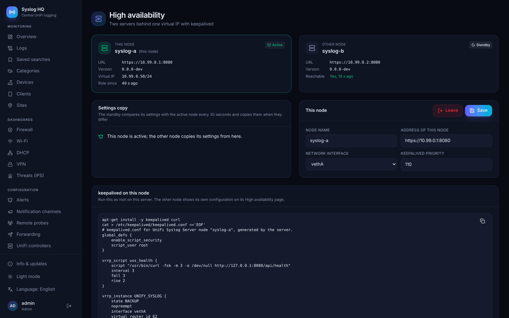
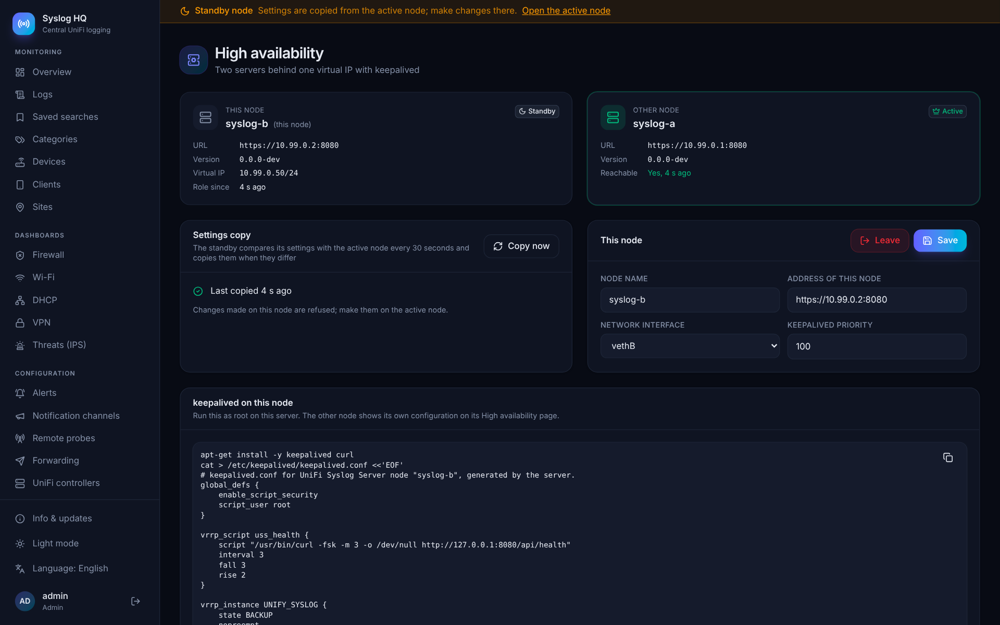

# High availability

Two UniFi Syslog Servers can share one virtual IP address with keepalived. UniFi devices and remote probes send to the virtual IP; when the server that holds it fails, keepalived moves the IP to the other server within seconds, and logging continues.

## How it works

- **One virtual IP.** keepalived runs on both servers and gives the virtual IP to one of them. A health check on `/api/health` moves the IP away from a server whose service stopped or lost ClickHouse. A server that comes back does not take the IP back (`nopreempt`), so the IP only moves when it has to.
- **One log store.** Both servers store logs in the same external ClickHouse server or cluster (see [STORAGE.md](STORAGE.md)). Searches, dashboards and exports show the same data on both.
- **One configuration.** The server that holds the virtual IP is *active*. The other one is *standby*: every 30 seconds it compares a fingerprint of its settings with the active node, and copies the settings database, the encryption key and the HTTPS certificate when they differ, then restarts. Users, settings, categories, alert rules, channels, forwarding destinations, probes and API tokens are therefore the same on both nodes.
- **Jobs run once.** Scheduled backups, alert rules, probe checks and the UniFi controller sync run on the active node only, and move with the virtual IP. Receiving syslog, forwarding and the System status page work on both nodes.
- **Changes on the active node.** The standby refuses changes, with a banner that links to the active node. Node-local settings stay open on both: the storage connection, the high availability setup and in-app updates.

## Requirements

- Two servers (VMs, physical servers or LXC containers) in the same layer-2 network, each with its own fixed IP, and a free address for the virtual IP. VRRP runs over unicast between the two addresses, so multicast is not needed.
- An external ClickHouse server or cluster that both can reach. Connect the first server to it under **Administration → Storage** before you start (the second server takes the connection over when it joins).
- The same version of UniFi Syslog Server on both nodes.

## Setting it up

1. **First server**: open **Administration → High availability → Start a pair**. Enter the virtual IP with its prefix length (e.g. `192.168.1.50/24`), a node name, the server's own address (e.g. `https://192.168.1.11:8080`), its network interface and a keepalived priority. The page then shows a pairing code.
2. **Second server**: on a fresh installation, open the same page, choose **Join a pair**, paste the code and fill in its own name, address and interface. The second server checks the first server's certificate against the code, registers itself, takes over the ClickHouse connection, copies all settings and restarts. Sign in again with the accounts of the first server.
3. **keepalived**: each node shows a ready-made command under **keepalived on this node**. Run it as root on that node. It installs keepalived and curl, writes `/etc/keepalived/keepalived.conf` and starts keepalived. Do this on both nodes.
4. Point UniFi devices (syslog) and remote probes at the virtual IP.

The pairing code contains the shared secret of the pair; treat it like a password. Both nodes authenticate each other with that secret and with the pinned fingerprint of each other's HTTPS certificate.

## Day to day

- The page shows the role of both nodes, when the other node was last reached and when the settings were last copied. **Copy now** on the standby copies right away.
- To update, update the standby first, then the active node. The virtual IP moves to the updated standby while the active node restarts.
- **Leave** turns high availability off on a node. Stop or remove keepalived on that node as well.
- Prometheus should scrape both nodes by their own address; `uss_ha_active` tells which one is active, and the bundled alert rule `UnifiSyslogNoActiveNode` fires when neither is. See [MONITORING.md](MONITORING.md).
- Each node reports its own problems (disk space, dropped packets) on the System status page and to the notification channels. A problem with the shared ClickHouse is therefore reported by both nodes.

## Files

| Path | Contents |
|---|---|
| `/var/lib/unify-syslog/node.yaml` | Node-local settings: the ClickHouse connection chosen in the interface and the high availability setup with the pair's secret. Never copied to the other node. |
| `/etc/keepalived/keepalived.conf` | Written by the command on the High availability page. |
