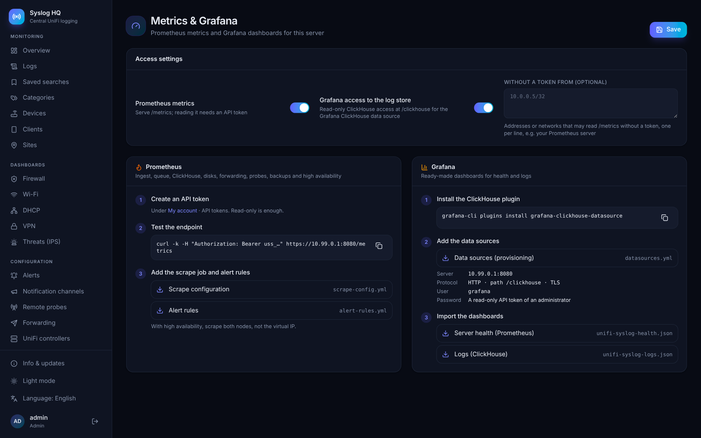

# Monitoring with Prometheus and Grafana

UniFi Syslog Server exposes Prometheus metrics and a read-only ClickHouse endpoint for the Grafana ClickHouse data source. Ready-made dashboards, a scrape configuration and alert rules can be downloaded under **Administration → Metrics & Grafana**.



## Prometheus

The metrics are served on the web port at `/metrics` (on by default). Reading them needs an API token, or a source address that is listed under **Without a token from**.

1. Create an API token under **My account → API tokens**. Read-only is enough; the token's user must be an administrator.
2. Test it:

   ```bash
   curl -k -H "Authorization: Bearer uss_..." https://syslog.example.com:8080/metrics
   ```

3. Add the scrape job (download *Scrape configuration*) to `prometheus.yml` and store the token in a file Prometheus can read:

   ```yaml
   scrape_configs:
     - job_name: unifi-syslog
       scheme: https
       tls_config:
         insecure_skip_verify: true   # only with the built-in self-signed certificate
       authorization:
         credentials_file: /etc/prometheus/unifi-syslog.token
       static_configs:
         - targets: ['syslog.example.com:8080']
   ```

4. Load the alert rules (download *Alert rules*): server down, ClickHouse down, no messages, dropped messages, disk almost full, forwarding failing, probe offline, no recent backup, and no active node in a high availability pair.

With [high availability](HA.md), scrape both nodes by their own address, not the virtual IP.

### Metrics

| Metric | Meaning |
|---|---|
| `uss_build_info{version,commit}` | Version of the server. |
| `uss_syslog_received_total`, `uss_syslog_received_by_protocol_total{protocol}` | Syslog messages received. |
| `uss_syslog_rejected_total` | Messages from sources not on the allowlist. |
| `uss_syslog_tcp_connections` | Open syslog TCP connections. |
| `uss_kernel_udp_receive_buffer_errors_total` | UDP packets the kernel dropped because the receive buffer was full. |
| `uss_ingest_parsed_total`, `uss_ingest_stored_total` | Messages parsed and stored. |
| `uss_ingest_dropped_total`, `uss_ingest_discarded_total`, `uss_ingest_insert_errors_total` | Messages lost because the queue was full, or because inserts kept failing; failed inserts. |
| `uss_ingest_queue_length`, `uss_ingest_queue_capacity`, `uss_ingest_pending` | Ingest queue. |
| `uss_ingest_last_insert_timestamp_seconds` | Time of the last successful insert. |
| `uss_clickhouse_up`, `uss_clickhouse_latency_seconds` | ClickHouse health. |
| `uss_clickhouse_parts`, `uss_clickhouse_max_parts_per_partition`, `uss_clickhouse_merges`, `uss_clickhouse_mutations`, `uss_clickhouse_memory_bytes` | ClickHouse internals. |
| `uss_disk_total_bytes{disk,path}`, `uss_disk_free_bytes{disk,path}` | Disks of the server and of ClickHouse (object storage excluded). |
| `uss_logs_rows{disk,type}`, `uss_logs_bytes{disk,type}`, `uss_logs_oldest_timestamp_seconds{disk}` | Stored logs per ClickHouse disk, hot and [cold](STORAGE.md#cold-storage). |
| `uss_status_issues{severity}` | Open problems on the System status page. |
| `uss_forward_up{destination,kind}`, `uss_forward_events_total`, `uss_forward_bytes_total`, `uss_forward_errors_total`, `uss_forward_rejected_total`, `uss_forward_dropped_total`, `uss_forward_queue_events`, `uss_forward_queue_bytes` | Forwarding per destination. |
| `uss_probes{state}`, `uss_probe_up{probe,site}`, `uss_probe_last_seen_timestamp_seconds`, `uss_probe_buffer_bytes` | Remote probes. |
| `uss_backup_last_success_timestamp_seconds`, `uss_backup_last_full_timestamp_seconds`, `uss_backup_last_failed`, `uss_backup_running` | Backups. |
| `uss_notify_queue{channel,kind}` | Notifications waiting per channel. |
| `uss_ha_enabled`, `uss_ha_active`, `uss_ha_last_sync_timestamp_seconds` | High availability. |
| `uss_process_resident_memory_bytes`, `uss_process_heap_bytes`, `uss_process_goroutines`, `uss_start_time_seconds` | The server process. |

## Grafana

Two dashboards are included:

- **Server health** (Prometheus data source): messages per second, drops, queue, ClickHouse, disks, forwarding, probes, backups and the role of each node.
- **Logs** (ClickHouse data source): events per category, firewall blocks with the top sources, ports and countries, Wi-Fi connections, IPS alerts and recent errors, filterable per site.

### Logs data source

Turn on **Grafana access to the log store**. The server then forwards ClickHouse HTTP queries under `/clickhouse` to its ClickHouse with `readonly=2`: Grafana can read, but cannot write, change tables or lift the read-only setting. Only API tokens of administrators are accepted, because a read query can still use table functions such as `url()` with the rights of the ClickHouse user.

1. Install the plugin: `grafana-cli plugins install grafana-clickhouse-datasource`.
2. Add the data sources, by hand or with the provisioning file (download *Data sources*) in `/etc/grafana/provisioning/datasources/`:

   | Setting | Value |
   |---|---|
   | Server address | the syslog server |
   | Server port | `8080` |
   | Protocol | HTTP, with *Secure connection* on (and *Skip TLS verify* with the built-in certificate) |
   | HTTP URL path | `/clickhouse` |
   | Username | anything, e.g. `grafana` |
   | Password | the API token |
   | Default database | `unify_syslog` |

3. Import the two dashboards (download *Server health* and *Logs*) and pick the data sources.

The `logs` table has the columns `ts`, `site`, `hostname`, `category`, `severity`, `action`, `src_ip`, `dst_ip`, `dst_port`, `message` and more; `logs_hourly` holds counts per hour, category and site for fast long-range panels.
