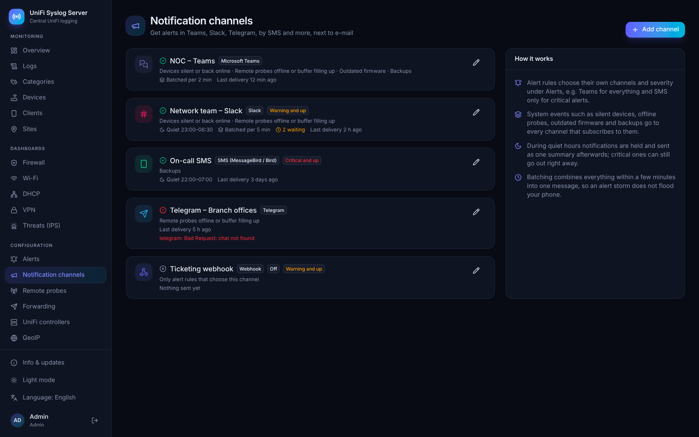

# Notification channels

Next to e-mail, the server can tell you about problems in **Microsoft Teams**, **Slack**, **Telegram**, by **SMS** (MessageBird or Bird), through **Pushover**, or with a **JSON webhook**. Add channels under **Configuration → Notification channels**.



## What goes where

- **Alert rules** pick their own channels. Under **Alerts**, each rule has a severity (info, warning or critical), a choice of channels and an on/off switch for e-mail. For example: everything to Teams, and SMS only for critical rules.
- **System events** go to every channel that subscribes to them:
  - devices that stop sending logs, and devices that come back (warning / info)
  - remote probes that go offline or whose buffer fills up (warning), and that recover (info)
  - outdated firmware (info)
  - backups: failed (critical) and succeeded (info)
  - system status: low disk space, ClickHouse unreachable or failing inserts, dropped syslog packets (warning or critical), and when the problem is over (info)
- **Minimum severity** per channel skips anything below it. Set an SMS channel to *Critical and up* and it only receives critical alerts and failed backups.

The e-mail settings of the inventory, probes and backups are unchanged; channels come on top of them.

## When it is sent

- **Quiet hours** (for example 22:00 to 07:00, in the server time zone set under Settings) hold notifications and send them as one summary when the quiet hours end. With *Critical notifications still go out*, critical ones are sent right away anyway.
- **Batching** collects notifications for a few minutes after the first one and sends them as one message, so an alert storm becomes one message instead of fifty. Critical notifications are never delayed.
- Notifications wait in the settings database, so a restart does not lose them. A failed delivery is retried with back-off (1, 2, 4… up to 30 minutes); after 36 hours an undelivered notification is dropped. The channel list shows the last delivery, the last error and how many notifications are waiting.
- Every channel has a **Send test message** button that sends with the settings in the form, before you save.
- Messages are written in the channel's language (English, Dutch, German or French), or in the server default.

If **Settings → Public base URL** is set, messages include a link to the web interface.

## Microsoft Teams

Teams uses a **Workflows** webhook (the Office 365 connectors are retired):

1. In Teams, open the channel, click **⋯ → Workflows**, and choose **Post to a channel when a webhook request is received**.
2. Pick the team and channel and finish the wizard.
3. Copy the URL it shows and paste it as **Webhook URL**.

Messages arrive as an Adaptive Card with the severity in color, the details, and a button to the web interface. The URL contains its own signature, so it is stored encrypted and masked afterwards.

## Slack

Either:

- **Incoming webhook**: create an app at [api.slack.com/apps](https://api.slack.com/apps), turn on *Incoming Webhooks*, add a webhook to the channel and paste its URL; or
- **Bot token**: give the app the `chat:write` scope, install it, invite the bot to the channel (`/invite @yourbot`), and enter the `xoxb-…` token and the channel name or ID.

## Telegram

1. Talk to [@BotFather](https://t.me/BotFather), send `/newbot` and copy the token.
2. Add the bot to your group (or start a chat with it).
3. Find the chat ID, for example by sending a message in the group and opening `https://api.telegram.org/bot<token>/getUpdates`. Group IDs start with `-100`.
4. For a group with topics, enter the topic ID to post in that topic.

## SMS (MessageBird / Bird)

- **MessageBird SMS API**: enter a live access key from the MessageBird dashboard, the sender (up to 11 letters, or a number) and the phone numbers in international format (`+31612345678`).
- **Bird (channels API)**: for accounts on the newer Bird platform, enter an access key, the workspace ID and the ID of an SMS channel.

Texts are cut to the maximum length (306 characters, two SMS, by default). Because SMS costs money and wakes people up, new SMS channels start with *Critical and up* and quiet hours from 22:00 to 07:00 that still let critical messages through.

## Pushover

Create an application at [pushover.net](https://pushover.net) and enter its token and your user or group key. Critical notifications are sent with high priority, info with low priority.

## Webhook

Each notification (or batch) is posted as JSON:

```json
{
  "instance": "UniFi Syslog Server",
  "severity": "critical",
  "title": "Alert: Critical IPS alert",
  "body": "Rule: Critical IPS alert\nQuery: category:ips severity:<=crit\n…",
  "count": 1,
  "time": "2026-10-18T19:42:00Z",
  "link": "https://syslog.example.com:8080"
}
```

With a signing secret, the header `X-USS-Signature: sha256=<hex>` holds the HMAC-SHA256 of the body. Extra headers (for example `Authorization: Bearer …`) are stored encrypted.

## API

See [API.md](API.md#notification-channels).
