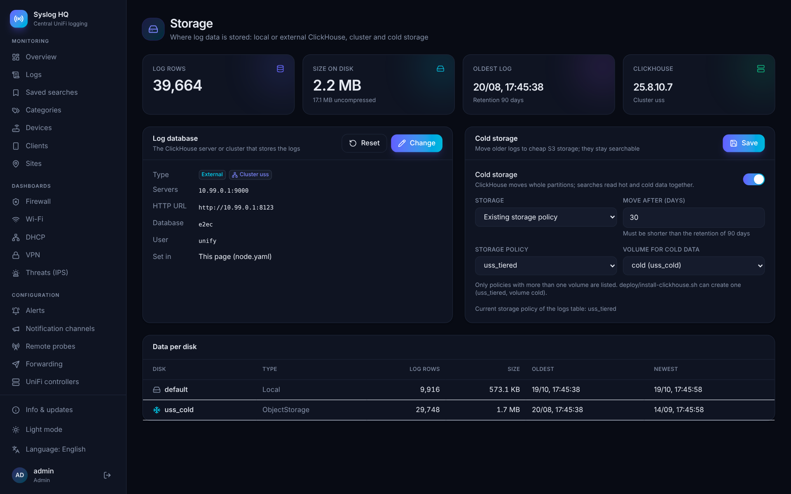
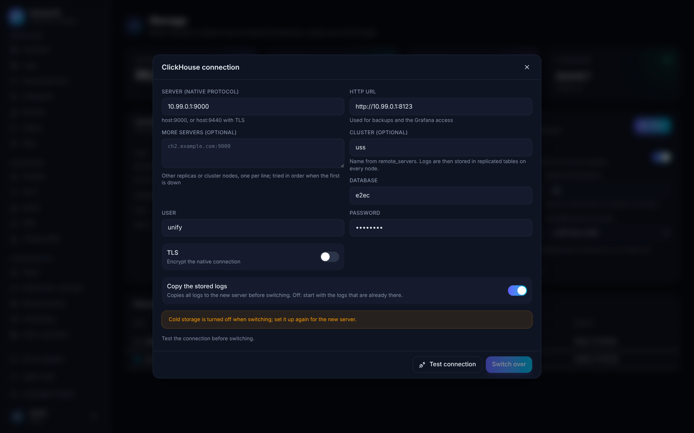

# Storage: external ClickHouse, clusters and cold storage

By default UniFi Syslog Server stores its logs in a ClickHouse server on the same machine. For larger environments the logs can live on a separate ClickHouse server or on a ClickHouse cluster, and older logs can move to cheap S3 storage while they stay searchable. Everything is managed under **Administration → Storage**.



The page shows the stored rows, the size on disk, the oldest log and the ClickHouse version, the connection in use, the cold storage settings and how the logs are spread over the disks.

## A separate ClickHouse server

### 1. Install the ClickHouse server

On a Debian 13 VM, physical server or LXC, run as root:

```bash
curl -fsSL https://raw.githubusercontent.com/rhisijmuiden/unifi-syslog-server/main/deploy/install-clickhouse.sh | bash
```

The script installs ClickHouse, lets it listen on all addresses, creates a `unify` user that may only connect from the networks in `USS_CH_ALLOW` and prints the settings to enter in the syslog server.

| Variable | Meaning |
|---|---|
| `USS_CH_ALLOW="10.0.0.0/8 192.168.0.0/16"` | Networks allowed to connect (default: the private ranges). |
| `USS_CH_PASSWORD=...` | Password of the `unify` user (generated otherwise, and kept on a re-run). |
| `USS_CH_TLS=1` | Also serve TLS on 9440 (native) and 8443 (HTTPS) with a self-signed certificate. |
| `USS_CH_MEMORY_RATIO=0.8` | Share of RAM for ClickHouse. |
| `USS_S3_ENDPOINT`, `USS_S3_BUCKET`, `USS_S3_PREFIX`, `USS_S3_REGION`, `USS_S3_ACCESS_KEY`, `USS_S3_SECRET_KEY`, `USS_S3_CACHE_GB` | Adds an S3 disk and the storage policy `uss_tiered` for [cold storage](#cold-storage). |

### 2. Connect the syslog server

**New installation**: let the installer skip the local ClickHouse:

```bash
curl -fsSL https://raw.githubusercontent.com/rhisijmuiden/unifi-syslog-server/main/deploy/install.sh | \
  USS_CLICKHOUSE=external USS_CH_ADDR=10.0.0.20:9000 USS_CH_HTTP_URL=http://10.0.0.20:8123 \
  USS_CH_USER=unify USS_CH_PASSWORD='...' bash
```

| Variable | Meaning |
|---|---|
| `USS_CLICKHOUSE=external` | Do not install ClickHouse on this machine. |
| `USS_CH_ADDR` | Native protocol address, `host:9000` (`host:9440` with TLS). More servers comma separated. |
| `USS_CH_HTTP_URL` | HTTP interface, used for backups and the Grafana access. |
| `USS_CH_USER`, `USS_CH_PASSWORD`, `USS_CH_DATABASE` | Credentials and database (default `unify_syslog`). |
| `USS_CH_SECURE=1`, `USS_CH_SKIP_VERIFY=1` | TLS, and accepting a self-signed certificate. |
| `USS_CH_CLUSTER=name` | Store the logs replicated on this cluster. |

**Existing installation**: open **Storage → Change**, fill in the server, test the connection and click **Switch over**. With **Copy the stored logs** on, the server first copies all logs to the new ClickHouse, day by day, with a progress bar; then it saves the connection and restarts. Without it, the server starts with whatever logs are already in the new database. Until the switch is done, the current ClickHouse stays in use, and a failed copy leaves everything as it was.



The connection chosen in the interface is stored in `/var/lib/unify-syslog/node.yaml` and takes precedence over `config.yaml`. **Reset** goes back to the connection in `config.yaml`.

## A ClickHouse cluster

Enter the name of the cluster (from `remote_servers` in the ClickHouse configuration) under **Cluster**. The server then creates:

- `logs_local` and `logs_hourly_local`: `ReplicatedMergeTree` tables on every node (`ON CLUSTER`), using the `{shard}` and `{replica}` macros;
- `logs` and `logs_hourly`: `Distributed` tables over them, used for inserts and searches.

The cluster needs ClickHouse Keeper (or ZooKeeper), the `{shard}` and `{replica}` macros on every node, and `interserver_http_host` set to an address the other nodes can reach. List more nodes under **More servers**: when the first cannot be reached the server connects to the next.

A database that already has a single-server `logs` table cannot be turned into a cluster in place; switch to a new database with **Copy the stored logs** on instead.

## Cold storage

Cold storage moves logs older than a number of days to S3-compatible object storage (MinIO, Wasabi, AWS S3, Backblaze B2 …) with ClickHouse tiered storage. Searches, dashboards and exports read hot and cold data together; reading cold data is slower, so a local cache keeps recently read parts. Logs are still deleted when they reach the retention period, which must be longer than the cold storage age.

**On the local ClickHouse**, choose *S3 bucket* and fill in the endpoint, bucket, folder, region, keys and cache size. The server writes the S3 disk and the storage policy to `/var/lib/unify-syslog-ch/storage.xml` (linked into `/etc/clickhouse-server/config.d/`), reloads ClickHouse and switches the logs table to the policy `uss_tiered`. Installations made before cold storage existed need one update as root to create that directory: in a Proxmox LXC, run the update command from the [README](../README.md#proxmox-lxc) inside the container; on a Debian VM or server, run the installer again:

```bash
curl -fsSL https://raw.githubusercontent.com/rhisijmuiden/unifi-syslog-server/main/deploy/install.sh | bash
```

The in-app update cannot do this, because the server does not run as root. When the endpoint or the keys of an existing S3 disk change, ClickHouse has to be restarted once (`systemctl restart clickhouse-server`); the page says so.

**On an external server or cluster**, add the S3 disk to the ClickHouse configuration of every node (`install-clickhouse.sh` does this with the `USS_S3_*` variables) and choose *Existing storage policy* with the policy and its cold volume. Only policies with more than one volume are listed.

Notes:

- ClickHouse cannot switch a table back to a policy without the cold volume. Turning cold storage off stops moving data; data that was moved stays where it is and readable.
- When you switch to another ClickHouse server, cold storage is turned off, because its disk belongs to the old server. Set it up again for the new one.
- The **Data per disk** table and the `uss_logs_rows` and `uss_logs_bytes` [metrics](MONITORING.md) show how much is stored hot and cold.
